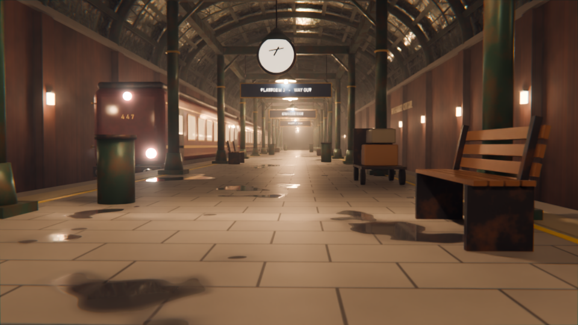

# Kingsbridge Central - a procedural cinematic train station

Built in reply to the BeyondTheBoxCN post about Claude modelling a 3D station in Blender + Tripo.
Everything here is generated by one Python script in Blender 4.5: all geometry, every shader
(node trees written in code, no texture files), the lighting, the camera, the compositor grade.
Text is Blender text objects (Arial Bold on Windows, DejaVu Sans Bold on Linux).
No Tripo, no image-generated textures, no GPU.



## Rendering on GitHub Actions

`.github/workflows/render.yml` renders in the cloud so no workstation has to stay busy:

- every push to `main` renders a half-res preview (smoke test, artifact `preview`)
- `Run workflow` (workflow_dispatch) renders the 1080p still and the 96-frame fly-through;
  the frames are split across N parallel jobs (default 24 x 4 frames), stitched with ffmpeg,
  and the MP4 + PNG are attached to a release tagged `run-<number>`

Blender 4.5.4 LTS is downloaded from blender.org on first use and cached. Inputs: `mode`
(preview / still / anim / all), `res` (%), `samples_still`, `samples_anim`, `chunks`.

Environment overrides the script understands: `STATION_ROOT`, `STATION_RES`,
`STATION_SAMPLES`, `STATION_FRAMES=a-b`.

## Run locally

```
"C:/Program Files/Blender Foundation/Blender 4.5/blender.exe" -b -P build_station.py -- preview 05
"C:/Program Files/Blender Foundation/Blender 4.5/blender.exe" -b -P build_station.py -- final 02
"C:/Program Files/Blender Foundation/Blender 4.5/blender.exe" -b -P build_station.py -- anim 02
```

| mode    | output                                   | settings                          | time on this PC (20 CPU threads) |
|---------|------------------------------------------|-----------------------------------|----------------------------------|
| preview | renders/preview_NN.png                   | 960x540, 64 spp, denoised         | ~65 s                            |
| final   | renders/final_NN.png + station.blend     | 1920x1080, 320 spp, denoised      | ~20 min                          |
| anim    | renders/flythrough_NN_0001-0096.mp4      | 960x540, 40 spp, 96 frames, 24fps | ~1 h                             |

## What is in the scene

- Island platform (wet concrete tiles with procedural puddles), tactile strips, yellow lines
- Two tracks on ballast (Voronoi gravel), sleepers via an Array modifier, bevelled rails
- Brick trainshed walls with pilasters, cornice and warm wall lanterns
- Elliptical cast-iron arch ribs with inner chord + zigzag lattice, purlins, glazed roof shell
  (the glazing-bar grid is a Brick texture on arc-length UVs mixed into the glass shader)
- Portal frames on the platform: columns, brackets, cross beams, pendant lamps
- Hanging station signs, a double-faced clock, benches, bins, a luggage trolley with suitcases
- A three-car burgundy train with lit windows, gold lining, bogies, buffers and headlight spots
- Dusk Nishita sky, a low orange sun shining through the open far end, homogeneous world fog
- Cycles CPU + OpenImageDenoise, AgX medium-high contrast, compositor bloom / grade / vignette

## Lessons

- A face of one object exactly coplanar with another object's face renders BLACK in Cycles
  (shadow rays are blocked by the twin face). Keep stacked parts a few millimetres apart.
- Writing this script through a Bash heredoc fails with ENAMETOOLONG on Windows; use a file write.
